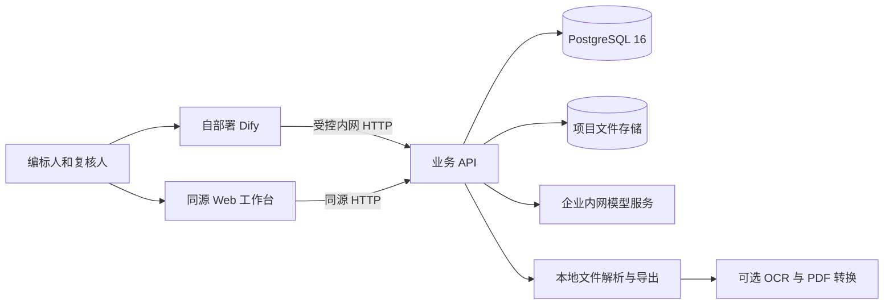
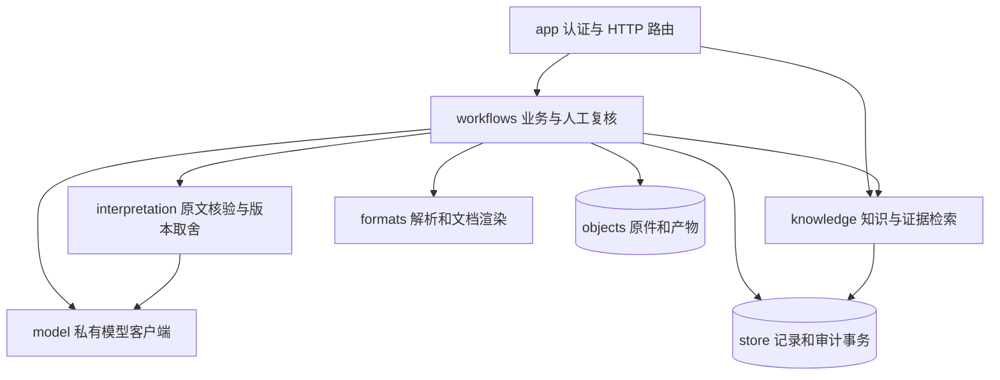
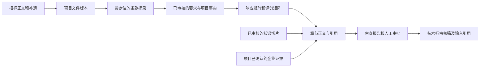

# 系统架构设计

系统把编标控制、资料复核、模型推理和成果归档连接在一起。前端工作台和 Dify 均通过内网业务 API 执行业务动作。服务器统一校验项目权限和资料版本，在数据库提交结果。

## 部署组件

| 组件 | 选择与职责 |
| --- | --- |
| Dify | 采用自部署实例，分别导入八份 Workflow。工作流校验参数并调用相应内网业务接口，保存运行结果与记录引用。审核身份和审批记录由后端管理。 |
| 工作台与 API | 采用同源静态工作台和 FastAPI。提供项目、文件、运行、版次、审批、知识和证据接口。 |
| 业务库 | Compose 部署 PostgreSQL 16。SQLite 支持本地开发与自动化回归。PostgreSQL 测试使用 Psycopg 和本机临时 WASM PostgreSQL，生产镜像单独验收。 |
| 文件存储 | 磁盘卷为默认存储，按租户和项目分配对象命名空间。对象使用 SHA-256 定位并校验，业务记录保留文件名、类型和修订。S3 兼容存储可按部署配置接入，企业可选择内网 MinIO。 |
| 本地模型 | 接入企业内网的 OpenAI 兼容服务。生成模型和可选嵌入模型通过环境变量配置。项目输入和文档片段经过内网地址校验后才发送给配置的模型。 |
| 解析与导出 | Python 本地解析模块处理 PDF、DOCX、XLSX、TXT。扫描件和图像使用可选本地 OCR，DWG 需专业工具转换。使用 Word 模板输出 DOCX，并可配置 LibreOffice 转 PDF。 |

## 模块关系

## 资料与证据流转

派生记录保留上游修订。在核准补遗、变更资料或作废知识版本后，后端重新检查既有审查与交付所依赖的版本。归档时应能从审核稿反向查到章节、项目原文、证据和复核记录。调用顺序见 [Dify 工作流设计](02_Dify工作流设计.md)，主键与事务见 [数据库设计](04_数据库设计.md)。
