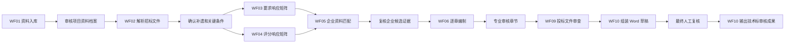

# Dify 工作流设计与试跑

第一阶段交付 `workflows/WF01.yml` 至 `WF06.yml`、`WF09.yml` 和 `WF10.yml`。每份文件都是一个独立的 Dify Workflow 应用。Dify 接收参数、校验输入、按条件选择调用路径，并返回运行状态。业务后端负责模型调用、企业知识检索、项目权限、版本检查和持久化。后台分别执行每次工作流调用，审计和人工审核状态以数据库为准。



## 导入和连接

1. 部署项目业务 API，按部署文档确认数据库、存储和本地模型可用。Dify 的容器及其 HTTP 代理须能访问业务 API 的企业内网地址。
2. 在 Dify 工作室导入一份 `workflows/WFxx.yml`，应用类型应为 Workflow。逐个导入所需工作流。
3. 在每个应用的环境变量中填 `BIAOSHU_API_BASE`，如同一容器网络中可解析的 `http://biaoshu-api:8091`。基址含协议，不带 `/v1`。填 Secret 类型的 `BIAOSHU_API_TOKEN`，其权限必须覆盖当前租户及相应项目。给审核人员分配独立的后端账号权限。
4. 先在工作流编辑器中试跑 WF01 和 WF02。实际版本与导入情况要记录在 `12_项目实施进度.md`。发布后才能用该应用自己的服务 API 密钥调用 Dify `/v1/workflows/run`，此密钥与业务后端令牌各自独立。

源码对照基线为 Dify 1.7.2 的 HTTP、代码和条件节点，以及官方 `0.3.1` 样例应用。Dify 默认 HTTP 超时可能小于项目解析及编制用时，按实际 Dify 版本和自身网络策略核对 HTTP 节点的超时上限以及代理超时。WF06 的请求可用 `chapter_ids` 缩小处理范围。保持 Dify 的 HTTP 代理防护，按部署环境配置访问业务 API 的特定内网路由。

[Dify 应用导入](https://docs.dify.ai/zh/cloud/use-dify/workspace/export-import-apps) · [HTTP 节点字段](https://github.com/langgenius/dify/blob/1.7.2/api/core/workflow/nodes/http_request/entities.py) · [HTTP multipart 文件数组实现](https://github.com/langgenius/dify/blob/1.7.2/api/core/workflow/nodes/http_request/executor.py) · [官方 Workflow DSL 样例](https://github.com/langgenius/dify/blob/main/api/tests/fixtures/workflow/conditional_hello_branching_workflow.yml)

## 节点和数据契约

| 节点 | 类型 | 输入和输出 | 失败处理 |
| --- | --- | --- | --- |
| 项目和执行参数 | 开始 | `project_id` 字符串，`request_json` JSON 文本，WF01 还有 `files` 本地文件数组 | WF01 新建时项目 ID 留空，其他流程必填真实项目 ID |
| 校验输入并生成请求 | Python 代码 | 校验项目 ID、参数字段及 JSON 格式，构造 JSON 或 multipart 表单字段 | 提示具体输入错误，失败时不发出请求 |
| 有项目文件 | 条件，WF01 专用 | `files` 非空走 multipart 上传，空值走 JSON 调用 | 两条分支分开输出同名字段 |
| 调用内网业务工作流 | HTTP 请求 | JSON `POST /v1/workflows/WFxx/run`，WF01 带文件时 `POST /v1/workflows/WF01/upload` | 写操作关闭自动重试，超时后先回查记录再复跑 |
| 识别业务状态 | Python 代码 | 对 HTTP 状态码和 JSON 响应提取状态 | `backend_error` 表示后端拒绝，`invalid_response` 表示成功码的正文非业务 JSON |
| 输出执行结果 | 结束 | `status` 字符串、`http_status` 数字和 `result_json` 原始响应文本 | 发布 API 中 Dify 执行成功时，仍需判断业务 `status` 和 HTTP 状态 |

业务后端可以返回待审核状态和记录引用。通过项目记录接口查看大文本及版本，附件走带鉴权的下载接口。提示词由后端按版本维护，统一规范见 [AI 提示词规范](08_AI提示词规范.md)。工作流可分别升级，修改共享 DSL 结构后运行 `python scripts/dify_workflows.py` 再提交生成物。

## 运行与验证

- `python scripts/dify_workflows.py --check` 检查当前 YAML 是否与生成源一致。
- `python scripts/verify_dify_workflows.py` 使用 PyYAML 或本机 Docker Compose CLI（无需启动守护进程）独立解析八份 YAML，复查图和变量选择器，并实测本地模拟服务的 WF01 multipart 与八条 JSON 请求。此验证覆盖 DSL 文件结构及通信契约。
- `python scripts/verify_dify_native_schema.py <可信的 Dify 1.7.2 源码目录>` 使用官方节点模型和版本检查函数审核 YAML，验证导入使用的版本标记，以及 Start、Code、If-Else、HTTP 和 End 节点字段。需 Python 3.11+、Pydantic 2 和 `packaging`。这一步在本机通过了八份工作流，与实际实例导入是两项验收。
- 真实实例验收需逐应用导入、填环境变量、发布或在编辑器试跑，对照 `doc/workflows/` 的输入和结果。上传测试同时覆盖两个文件、文件角色、空数组 JSON 分支。人工审批使用业务后端独立身份，不将确认状态作为模型入参伪造。
- 从真实 Dify 验收时，应保存应用版本、项目 ID、输入文件版本、Dify 执行 ID、后端记录引用和各阶段状态。脚本 [run_dify_smoke.py](../scripts/run_dify_smoke.py) 可请求已发布应用，应用密钥从环境变量读取。

例如，在本地已工作的 Dify 中发布 WF01 后，给当前进程配置 `DIFY_BASE_URL` 和 `DIFY_WF01_KEY`，以合成文件执行以下命令。`示例参数.json` 包含 WF01 的项目名及文件角色映射。

```text
python scripts/run_dify_smoke.py WF01 --request 示例参数.json --upload 招标正文.txt --upload 补遗一.txt
```

读取 `project_id` 后执行文档指定的中间审核，再用 `python scripts/run_dify_smoke.py WF02 --project-id 项目ID` 逐段继续。CLI 输出执行 ID、项目 ID、业务状态和 HTTP 状态，详单以项目记录为准。[Dify API 指南](https://docs.dify.ai/en/api-reference/guides/get-started)

