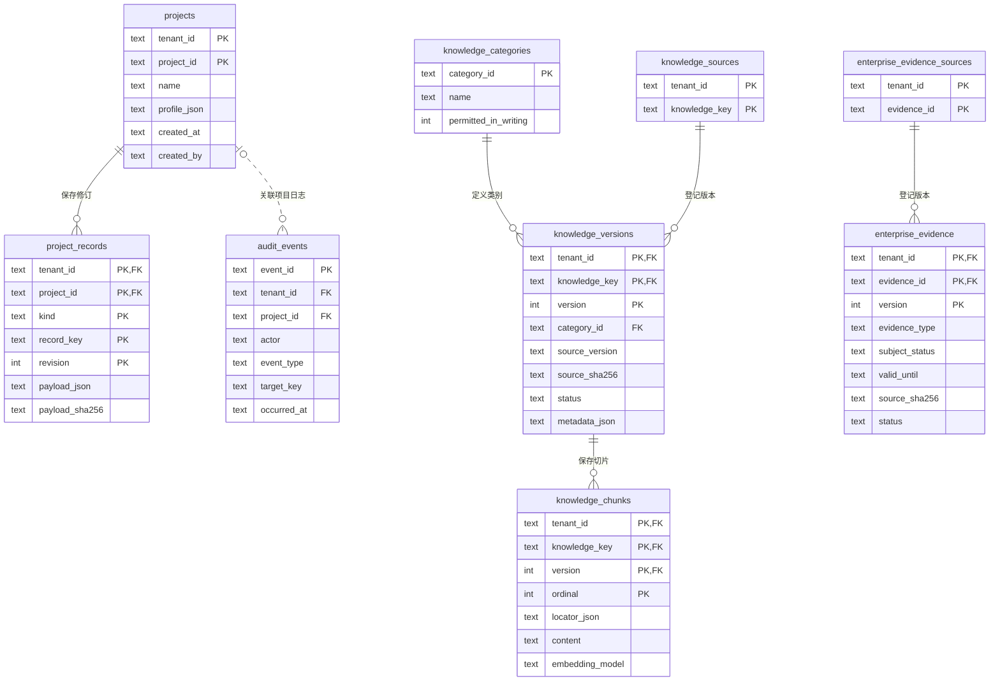

# 数据库设计

部署使用 PostgreSQL 16。`db/001_schema.sql` 建表及索引，`db/002_seed.sql` 初始化八个知识分类。部署容器可挂载两个脚本到 `/docker-entrypoint-initdb.d`，应用启动时也可由 `Store.init()` 幂等执行。开发与离线回归可使用 SQLite 文件，执行同一套 SQL。连接由 `BIAOSHU_DATABASE_URL` 提供，生产以部署环境传入凭据。



| 表 | 业务内容与主要字段 |
| --- | --- |
| `projects` | `tenant_id` 和 `project_id` 确定项目范围。`profile_json` 保存专业、地区及其他项目属性。 |
| `project_records` | 一个工作流记录可留多份修订。`kind` 区分项目文件、解读、要求、评分、匹配、章节、复核及成果清单。`record_key` 是逻辑标识，`revision` 是修订号，`payload_sha256` 是序列化内容的 SHA-256。文件实体还在业务内容记录原件哈希、文件 ID 和文件版本。 |
| `knowledge_categories` | 八个知识分类及是否可用于技术标生成。 |
| `knowledge_sources`、`knowledge_versions` | 资料逻辑编号与版本。版本保存类别、原件版本、原件位置、原件哈希、有效期、保密级别、元数据及审核信息。 |
| `knowledge_chunks` | 资料版本内的切片序号、文本、来源位置以及可选的模型和嵌入向量。 |
| `enterprise_evidence_sources`、`enterprise_evidence` | 结构化证据编号及各版本的类型、适用专业、主体现状、有效期、原件来源、审核状态和业务字段。 |
| `audit_events` | 租户、项目（企业知识事件可空）、操作者、动作、对象及时间。记录审批和修订等变更元数据。 |

业务字段用文本保存标准 JSON，并在应用接口校验。日期为 `YYYY-MM-DD`，事件时间为 UTC ISO 8601。项目、项目记录与审计日志使用复合外键，知识和证据的版本、切片也采用包含租户字段的复合键。访问层用凭据解析出的租户 ID 约束读写。数据库凭据仅授予后端服务和运维。SQLite 只用于本地开发和回归。

同一项目的记录批量写入在一个事务内完成。提交时可附带上游记录的 `preconditions` 或当前记录的 `expected_revision`，以避免旧资料上的审批覆盖新版。并发变更返回冲突，由操作者重新读取当前版本。相同内容重提直接返回同一修订。知识及证据发布时锁定逻辑来源，再更新旧版状态和新版状态。部分唯一索引保证同一资料同时只有一个审核通过的版本。

测试覆盖上下游前置版本冲突、事务回滚、并发草稿提交、跨租户读写、草稿和过期证据过滤、知识切片定位和已发布资料作废。生产备份须同时保存数据库和业务文件，恢复时按记录中的原件 URI、SHA-256 和修订重新核对。

## SQL 与访问层验证

2026 年 11 月 16 日执行了两组数据层回归。SQLite 文件数据库完成 5 项测试，包含并发修订。Psycopg 3.2.9 通过本机 TCP 接入临时内存 PostgreSQL 18.6（PGlite 0.5.16），执行两份 SQL 并反复初始化，完成其余 4 项测试，验证脚本的 PostgreSQL 方言、事务回滚、租户隔离、知识版本发布和替换、语义检索过滤及企业证据有效期。生产 Compose 镜像 PostgreSQL 16 的运行仍需部署方复跑。

用支持 Python 3.12 的本地环境安装项目依赖后，从仓库根目录执行以下 PowerShell 命令运行 SQLite 回归。

```powershell
$env:PYTHONPATH = 'src'
python -m unittest discover -s tests -p 'test_store_knowledge.py' -v
```

在 PostgreSQL 16 上复跑时，把 `BIAOSHU_TEST_POSTGRES_DSN` 设置为专用测试库的连接串，再运行同一条命令。测试角色需要创建临时 schema 的权限。每个测试随机创建独立的 `biaoshu_test_*` schema，退出时清理该 schema。测试环境可以使用容器内的 Postgres 服务，避免将数据库端口暴露到外网。
